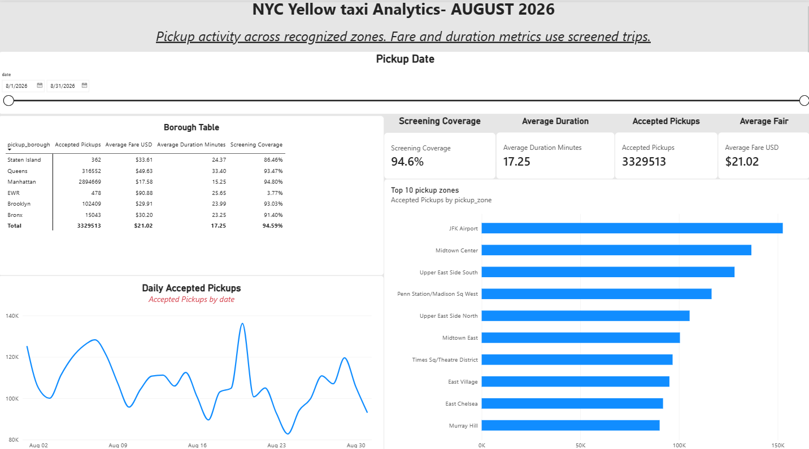
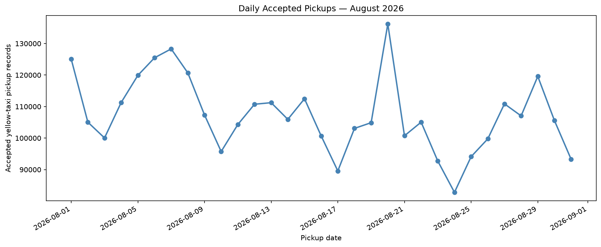
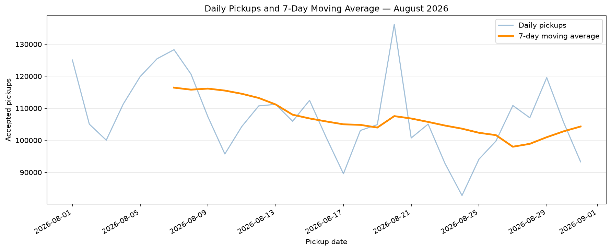
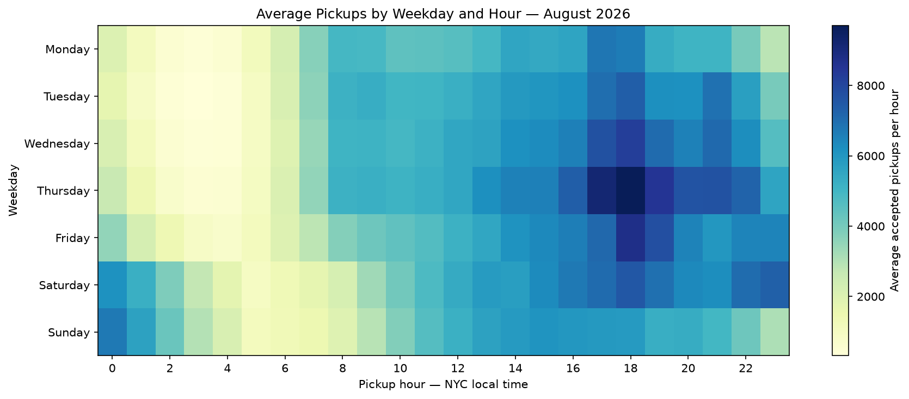
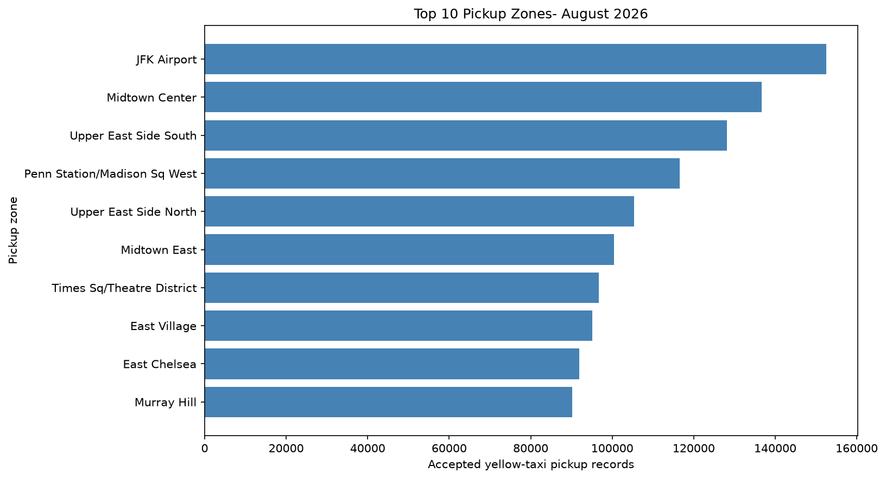
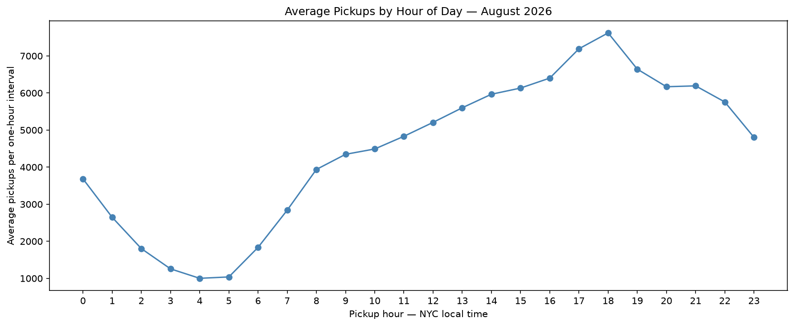
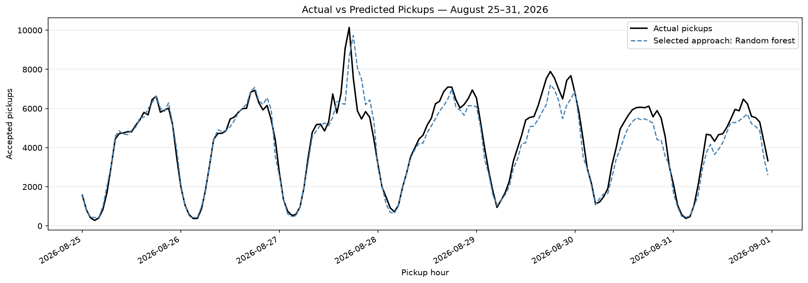
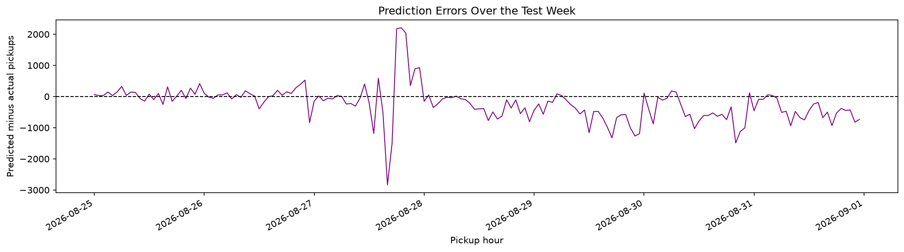
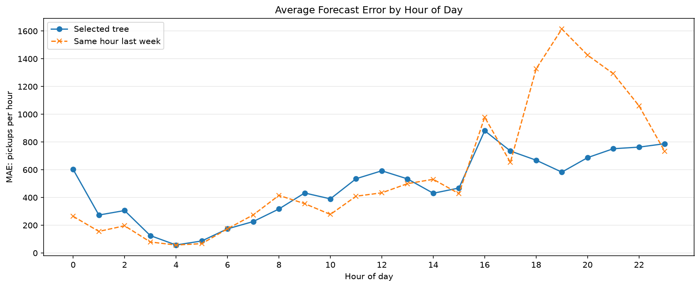

# NYC Yellow Taxi Demand Analytics and Hourly Forecasting

An end-to-end analytics and forecasting project using NYC Yellow Taxi
trip records for August 2026. The workflow combines Python data
preparation, exploratory analysis, SQL querying, Power BI reporting,
and machine-learning models to forecast accepted pickups one hour ahead.

The project is designed as a portfolio demonstration of **Data
Analytics, Data Science and applied Machine Learning**. It is a
historical study, not a live demand-forecasting service.

## Project highlights

| Area | What this project demonstrates |
|---|---|
| Data volume | 3.34 million source trip records |
| Data preparation | 3,329,513 accepted pickup records in recognised zones |
| Metric screening | 3,149,299 records retained for fare, distance and duration analysis |
| Analytics grain | Daily pickup-zone fact table with date and zone dimensions |
| SQL | Joins, aggregations, CTEs, `LAG()`, window frames and data-quality checks |
| Forecasting target | Aggregate accepted pickups in the next hour |
| Features | 1-hour, 24-hour and 168-hour lags; past-only rolling means; calendar features |
| Models | Same-hour-last-week baseline, Decision Tree, Random Forest |
| Reporting | Interactive Power BI dashboard with DAX measures and filters |

## Skills demonstrated

**Data Analytics**
- Data profiling, missing-value and outlier inspection.
- Separate definitions for accepted pickup counts and screened trip metrics.
- Daily, hourly, weekday/weekend, borough and pickup-zone segmentation.
- Data modelling with a daily-zone fact table and date/zone dimensions.
- Power BI dashboard design and DAX reporting.

**SQL and Data Engineering**
- SQLite database creation and loading from Pandas.
- Multi-table joins with key-integrity checks.
- Aggregations, CTEs, `LAG()` and seven-day window calculations.
- Validation that SQL totals reconcile with Pandas totals.
- Reusable query collection in [`sql/analytics_queries.sql`](sql/analytics_queries.sql).

**Data Science and Machine Learning**
- Time-ordered train, validation and test periods.
- Leakage-conscious lag and rolling feature construction.
- Seasonal baseline comparison.
- Decision Tree depth comparison and Random Forest regression.
- MAE, WAPE and signed-error analysis.
- Residual analysis by time and hour of day.

## Dashboard preview



The Power BI report is included in the repository:
[Download the Power BI dashboard](powerbi/Urban_Mobility_Dashboard.pbix).

## Data source and scope

Source: [NYC Taxi and Limousine Commission — Trip Record Data](https://www.nyc.gov/site/tlc/about/tlc-trip-record-data.page).

Files used:
- `yellow_tripdata_2026-08.parquet`
- `taxi_zone_lookup.csv`

The notebook initially reads 3,336,716 trip records. After restricting
pickup timestamps to August 2026 and excluding unrecognised pickup-zone
codes, 3,329,513 accepted pickup records remain. A separate screening
rule for fare, distance and duration retains 3,149,299 records for
those metric analyses.

The screening bounds are project assumptions, not official TLC
definitions of invalid trips. Raw trip data is not stored in this
repository; download it separately.

## Data preparation and analytics

The project:
1. Parses pickup and drop-off timestamps and derives trip duration.
2. Restricts the study to August 2026 and recognised pickup zones.
3. Retains accepted trips for pickup-volume analysis.
4. Applies separate screening rules to fare, distance and duration metrics.
5. Aggregates accepted pickups and screened metrics by date and pickup zone.
6. Builds `fact_daily_zone`, `dim_date` and `dim_zone` tables.
7. Loads the tables into SQLite and validates joins and totals.

The fact table contains 7,368 date-zone rows. The accepted pickup
counts reconcile to the source-level accepted trip count.

### Data-quality accounting and descriptive finding

Of the 3,336,716 source rows, 15 were outside August or had a missing
pickup timestamp, and 7,188 August rows had unrecognised pickup zones.
The remaining 3,329,513 records form the accepted-pickup population.
For fare, distance and duration analysis, a separate screening step
retained 3,149,299 records.

In the August sample, average daily weekend pickups were 109,422.80,
compared with 106,442.14 on weekdays — approximately **2.8% higher**.
This is a descriptive comparison for one month, not evidence that
weekend status causes higher demand.

### Selected exploratory visualisations

**Daily pickup trend**



**Daily pickups with seven-day moving average**



**Pickup distribution by hour and weekday**



**Busiest pickup zones**



**Average pickups by hour**



### SQL analysis

The standalone SQL file contains examples for:
- Top pickup zones and borough-level summaries.
- Weighted average fare and duration.
- Weekday/weekend comparisons.
- Day-over-day pickup changes using `LAG()`.
- Seven-day moving averages using window frames.
- Join-integrity checks.

Run these queries after executing the notebook section that creates
the SQLite tables. The notebook saves the database at
`data/urban_mobility.db`.

### Power BI

The dashboard uses the daily-zone fact table and date/zone dimensions
to report pickup patterns by date, hour, weekday, borough and zone.
The PBIX file is available in `powerbi/`; refresh its local data-source
paths after regenerating the processed CSV files.

## Hourly forecasting

**Prediction target:** accepted yellow-taxi pickups during the hour
being predicted, aggregated across recognised pickup zones.

The hourly series contains 744 observations for August. Lag and rolling
features require prior history, so the modelling table contains 576
complete hourly rows beginning August 8.

### Features

| Feature | Meaning |
|---|---|
| `pickups_lag_1` | Accepted pickups in the previous hour |
| `pickups_lag_24` | Accepted pickups at the same hour on the previous day |
| `pickups_lag_168` | Accepted pickups at the same hour seven days earlier |
| `pickups_mean_previous_3h` | Mean pickup count over the three completed previous hours |
| `pickups_mean_previous_24h` | Mean pickup count over the 24 completed previous hours |
| `hour_of_day` | Target hour |
| `day_of_week` | Target weekday |
| `is_weekend` | Whether the target date is Saturday or Sunday |

Rolling means are shifted before calculation so the target hour's
actual pickup count is not included. Calendar variables are known in
advance. The forecast assumes that the previous hour's pickup count is
available and finalised before the next-hour prediction is made.

### Evaluation design

| Period | Dates | Role |
|---|---|---|
| Initial fit | August 8–17 | Fit candidate models |
| Validation | August 18–24 | Compare tree depths, Random Forest and weekly baseline |
| Exploratory test | August 25–31 | Compare the selected approach with the weekly baseline |

After validation selection, the Random Forest was refitted on
August 8–24. The test week contains 168 hourly predictions.

### Forecasting results

**Validation MAE**

| Approach | Validation MAE (pickups/hour) |
|---|---:|
| Same hour last week | 423.03 |
| Best single decision tree | 453.43 |
| **Random Forest** | **351.97** |

**Exploratory test-week MAE**

| Approach | Test MAE (pickups/hour) |
|---|---:|
| Same hour last week baseline | 571.23 |
| **Random Forest** | **414.04** |

The Random Forest's test-week MAE was approximately **27.5% lower**
than the same-hour-last-week baseline. Its mean signed error
(prediction minus actual) was **−230.82 pickups per hour**, indicating
an overall tendency to underpredict during this week.

### Forecast visualisations

**Actual versus predicted pickups**



**Forecast errors over time**



**Error by hour of day**



*The last chart is the earlier decision-tree error analysis, not the
final Random Forest comparison.*

### Important evaluation qualification

The August 25–31 period was inspected during development, including
an earlier exploratory decision-tree experiment before the final
validation-based model selection. Therefore, the reported test-week
scores are **exploratory and are not an untouched final holdout
estimate**. The project does not claim that the 27.5% reduction will
generalise to later months.

A stronger next evaluation would reserve a later month or multiple
future weeks that are not used during feature or model selection.

## Repository structure

```text
nyc-taxi-analytics-forecasting/
├── images/                 # Dashboard and analysis/forecast charts
├── notebooks/
│   └── urban_mobility_analysis.ipynb
├── powerbi/
│   └── Urban_Mobility_Dashboard.pbix
├── sql/
│   └── analytics_queries.sql
├── data/                   # Local raw and processed data (not committed)
├── .gitignore
├── README.md
└── requirements.txt
```

## How to run

### 1. Clone the repository

```bash
git clone https://github.com/crayoni/nyc-taxi-analytics-forecasting.git
cd nyc-taxi-analytics-forecasting
```

### 2. Create an environment and install dependencies

```bash
python -m venv .venv
```

Activate it:

```bash
# Windows PowerShell
.venv\\Scripts\\Activate.ps1

# macOS / Linux
source .venv/bin/activate
```

Install dependencies:

```bash
python -m pip install --upgrade pip
pip install -r requirements.txt
```

### 3. Download the input files

Download the August 2026 yellow-trip Parquet file and the taxi-zone
lookup CSV from the TLC source. Place both files in:

```text
data/raw/
├── yellow_tripdata_2026-08.parquet
└── taxi_zone_lookup.csv
```

This local data directory is ignored by Git.

To use a different input directory, set the environment variable:

```powershell
# Windows PowerShell
$env:NYC_TAXI_DATA_DIR = "D:\\path\\to\\nyc-taxi-data"
```

### 4. Run the notebook

Launch Jupyter from the repository root:

```bash
jupyter notebook
```

Open
[`notebooks/urban_mobility_analysis.ipynb`](notebooks/urban_mobility_analysis.ipynb)
and run the cells in order. The notebook locates the repository root,
reads inputs from `data/raw/` by default, and writes intermediate
tables/database files under `data/processed/` and `data/`.

### 5. Open the Power BI report

Open
[`powerbi/Urban_Mobility_Dashboard.pbix`](powerbi/Urban_Mobility_Dashboard.pbix)
in Power BI Desktop. Update local CSV data-source paths if you have
regenerated the processed tables.

## Limitations and next steps

- The analysis covers one month only and cannot establish seasonal patterns.
- The test period was inspected during development; scores are exploratory.
- Forecasting assumes each prior hour's count is available and finalised.
- Public monthly files are not a live operational forecasting feed.
- Recorded pickups do not measure unmet passenger demand or driver availability.
- Fare, distance and duration screening thresholds are project assumptions.
- A later untouched chronological period is needed for stronger validation.
- Useful extensions include holiday/weather/event features, additional
  months, rolling-origin backtesting, prediction intervals and forecast
  monitoring.

## Tools

Python, pandas, NumPy, Matplotlib, PyArrow, scikit-learn, SQLite,
Jupyter Notebook, Power BI and DAX.
