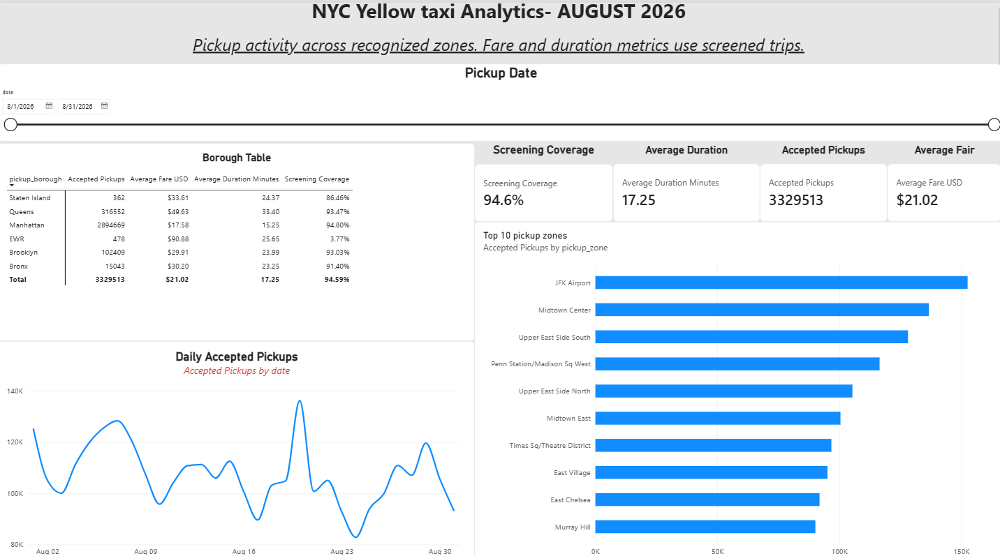
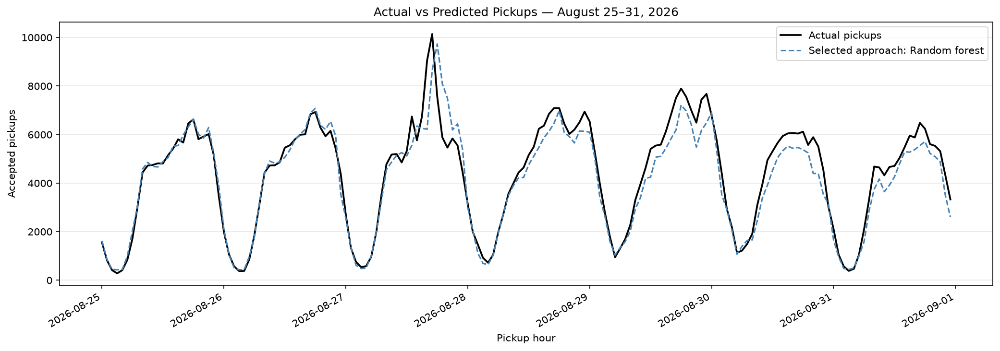

# NYC Yellow Taxi Analytics and Hourly Pickup Forecasting

## Overview

This project analyses August 2026 NYC yellow taxi records and explores
forecasting accepted pickups one hour ahead across recognised pickup zones.

The project combines Python data preparation, SQL analysis, Power BI reporting and machine learning using decision tree and random forest regressors.

## Dashboard Preview

## Tools

- Python, Pandas and NumPy
- Matplotlib
- SQLite
- Power BI and DAX
- Scikit-learn

## Data Source

NYC Taxi and Limousine Commission trip records:

https://www.nyc.gov/site/tlc/about/tlc-trip-record-data.page

Files used:
- yellow_tripdata_2026-08.parquet
- taxi_zone_lookup.csv

Raw trip data is excluded from this repository.

## Data Preparation

- Restricted pickup timestamps to August 2026.
- Excluded unrecognised pickup zone codes from the study.
- Retained accepted pickups for activity counts.
- Applied separate screening rules for fare, distance and duration metrics.
- Created daily zone aggregates and calendar and zone lookup tables.

The notebook documents the screening thresholds.

## Analytics and Dashboard

- Daily and hourly pickup patterns
- Weekday and weekend comparisons
- Borough summaries and busiest pickup zones
- SQL joins, aggregations and window functions
- Power BI measures, charts and interactive filters

## Forecasting

Target: accepted pickups during the hour being predicted.

Inputs include:
- Previous hour's pickups
- Same hour yesterday
- Same hour seven days earlier
- Previous 3-hour and 24-hour pickup averages
- Target hour, weekday and weekend indicator

Lag and rolling features use earlier pickup counts only.

Methods compared:
- Same-hour-last-week baseline
- Decision tree
- Random forest

## Evaluation Design

- Initial training: August 8–17
- Validation: August 18–24
- Existing test period: August 25–31

The validation-selected trained model was refitted on August 8–24.
If the baseline was selected, no fitting was required.

## Exploratory Machine Learning Results

The random forest achieved the lowest validation MAE among the
approaches compared. It was then refitted on August 8–24 and evaluated
on August 25–31.

| Approach | Test MAE: pickups per hour |
|---|---:|
| Same-hour-last-week baseline | 571.23 |
| Random forest | 414.04 |

The random forest reduced MAE by approximately **27.5%** relative
to the weekly baseline during this exploratory test period.

Its mean signed error was **−230.82 pickups per hour**. With error
defined as prediction minus actual, this indicates underprediction
by approximately 231 pickups per hour on average.

### Actual vs Predicted Pickups

### Data Science and ML Methods

- Engineered pickup lags of 1, 24 and 168 hours.
- Created rolling averages using only earlier hours.
- Added calendar features for the hour being predicted.
- Trained decision tree and random forest regression models.
- Selected the approach using chronological validation.
- Analysed absolute errors and systematic overprediction or
  underprediction.

### Evaluation Qualification

The August test period was inspected during development.
These scores are exploratory, rather than an untouched final
evaluation. Additional chronological data is needed to assess
performance beyond this month.

## How to Run

1. Install the packages listed in requirements.txt.
2. Download the trip data and zone lookup from the source above.
3. Open notebooks/urban_mobility_analysis.ipynb.
4. Set project_dir to your local project folder.
5. Check the data-loading paths against your downloaded file locations.
6. Run the notebook cells in order.
7. Open the Power BI report and update its CSV source paths if necessary.

## Limitations

- This is a one-month learning exercise.
- The test period was inspected during development, so its scores are
  exploratory rather than an untouched final evaluation.
- Evaluation assumes earlier hours' counts are available and finalised
  before the next hour is predicted.
- Public monthly files do not provide a live forecasting feed.
- Recorded pickups do not measure unmet requests or driver availability.
- Screening bounds are project assumptions.
- Further chronological data is needed for a stronger evaluation.
